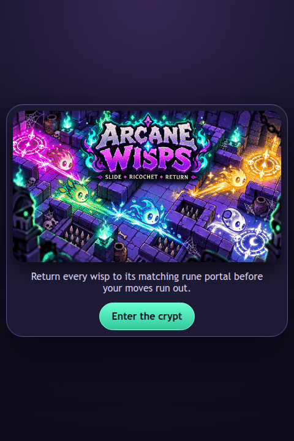
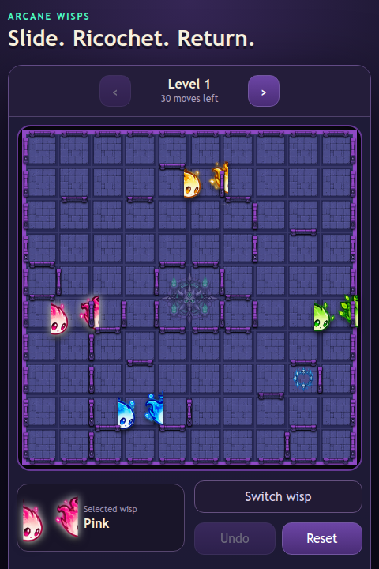

# Arcane Wisps for Devvit

A React and TypeScript sliding puzzle game for Reddit's Devvit Web runtime.

## Development

```bash
npm install
npm run validate
npm run dev
```

The browser preview runs without Reddit credentials. To test inside Reddit, authenticate with `npm run login` or `npx devvit login`, then run `npm run playtest` from this directory.

The game includes all 140 built-in levels. Progress uses browser-local storage; gameplay simulation remains independent of React in `src/client/game/engine.ts`.

## Local browser preview (no Reddit account needed)

`npm run dev` requires a Devvit login. To just look at the game locally:

```bash
cd devvit
npm install
npm run build                      # vite build → dist/client + dist/server
cd dist/client && python3 -m http.server 8185
```

Then open:

- `http://127.0.0.1:8185/splash.html` — splash screen ("Enter the crypt" only works inside Reddit)
- `http://127.0.0.1:8185/game.html` — the actual game board with all 140 levels

Screenshots can be regenerated from a built `dist/client` being served on a port:

```bash
node tools/capture-screenshots.cjs http://127.0.0.1:8185 screenshots
```

## Screenshots

| Splash | Guide | Game |
|---|---|---|
|  |  |  |
